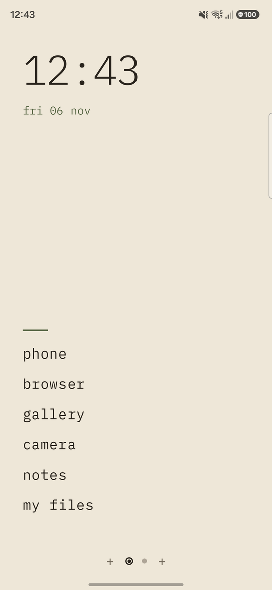
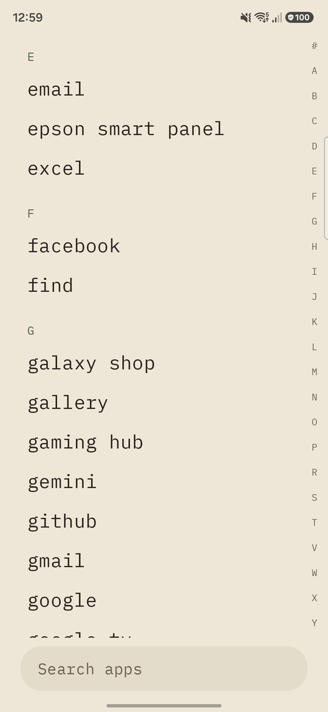
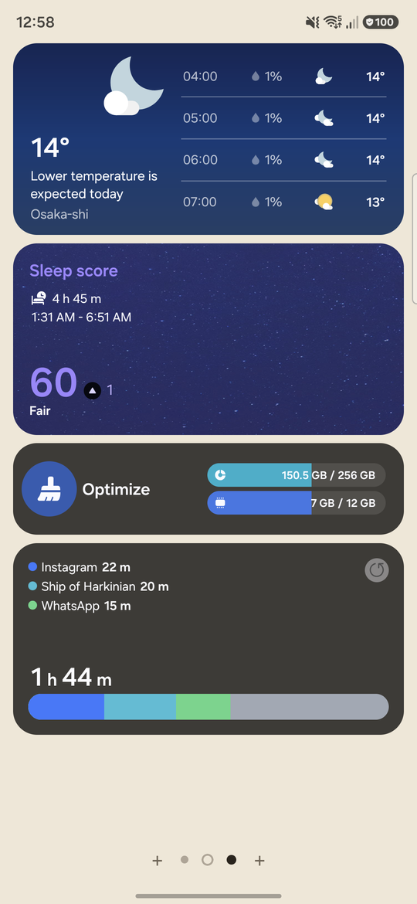
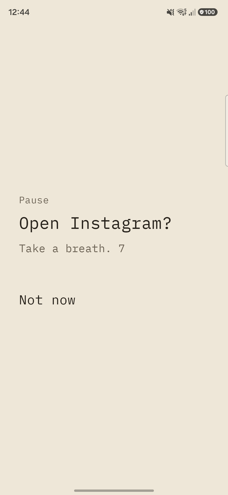
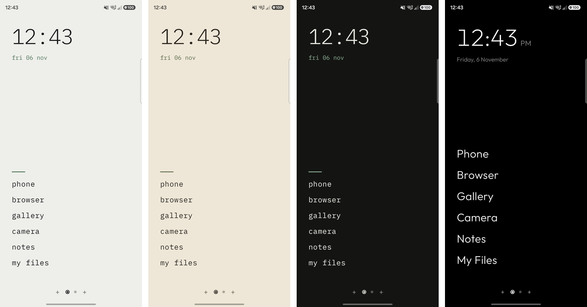

# Luma

A minimal Android launcher built to cut screen time and distractions. The home screen is a quiet page of text
with a few pinned apps; everything else is a swipe away. It keeps what a daily launcher still needs, widgets
included.

Built with Kotlin and Jetpack Compose. It is developed and tested on a Samsung Galaxy A56 (One UI), and works
with any Android 10+ device, though some widget niceties are Samsung-specific (see
[Samsung widgets](#samsung-widgets)).

## Screenshots

<table>
  <tr>
    <td align="center"><br><sub>Home</sub></td>
    <td align="center"><br><sub>App drawer</sub></td>
    <td align="center"><br><sub>Widget page</sub></td>
    <td align="center"><br><sub>The pause before a distracting app</sub></td>
  </tr>
</table>

<p align="center">
  <br>
  <sub>Paper, Paper Warm, Paper Dark and Graphite</sub>
</p>

## What it does

- **Home page.** A large clock and date, and a text-only list of the apps you pin. Long-press an app and drag
  to reorder; long-press and let go for unpin, app info and uninstall.
- **App drawer.** Swipe up from anywhere. An alphabetical list with an A–Z side bar and a search field at the
  bottom: results sit just above the field, best match nearest your thumb, and names that start with what you
  typed come first. Optionally shows app icons, all in the same rounded-square shape. Swipe up from the right-hand strip of the screen to open it with the search field
  focused and the keyboard up.
- **Widget pages.** Swipe sideways to pages of widgets on a 4-column grid, on either side of home. A `+` at
  each end of the page dots adds a page; the home page's dot is a ring.
  - Long-press a widget to select it, then drag to move it (the grid and target cells are shown).
  - Drag the selected widget's border to resize it. It stretches like a rubber band and snaps to whole cells.
  - Remove it, or open its settings, with the buttons on the selected widget.
  - Long-press empty space for the page menu (add widget, remove page).
- **Widget picker.** Previews at true relative size, one card per widget with a preview for each size it
  offers, searchable by app or widget name. Tap to add, or long-press and drag a widget straight onto a page.
- **Themes.** Paper, Paper Warm and Paper Dark (monospace, left-aligned), Graphite (true black, hairline type)
  and Custom (your own wallpaper, or a collection that changes daily). With Day / Night on, one theme is used by day and another by night, switching at times you choose. A theme sets colours, background,
  typeface, alignment and clock format everywhere, including the status bar icons.
- **Distracting apps.** Mark apps in Settings; opening one shows a 10-second pause first, with "Not now" always
  available. Passing it allows a set number of minutes (default 5) during which the app opens freely. Turn on
  Luma's accessibility service to get a "Time's up" page over the app, with a Close button, when it is over; an app opened from a notification gets
  the same pause as one opened from Luma.
- **Languages.** English, Spanish and Japanese. Luma follows the system language; on Android 13+ you can also
  pick one for Luma alone in the system's app language settings.
- **Settings.** The first row of the app drawer, "Luma Settings" (also found by searching). Grouped as:
  - *Look:* Appearance, with the theme choice (or a Day / Night pair with switch times), the Custom wallpaper
    picker and the app icons switch;
  - *Focus:* Distracting apps (which apps wait behind a pause) and Time limit (minutes per pass, and the
    accessibility service that enforces it);
  - *Phone:* Default launcher, to make Luma your home app, and How Luma works, which replays the walkthrough.
- **First run.** A short interactive tour opens on a fresh install: a small phone on each page to try the gesture
  on (swipe up, swipe up on the right, swipe sideways, long-press).

Not built yet: the features the launcher is for. See the [roadmap](#roadmap).

## Requirements

- A full JDK, 17 or newer (a JRE is not enough: Gradle needs `javac`). JDK 21 works.
- The Android SDK with platform 36 and the matching build tools.
- A device or emulator running Android 10 (API 29) or newer.

## Build and run

1. Tell Gradle where the Android SDK is, in a `local.properties` file at the repo root (it is git-ignored):

   ```properties
   sdk.dir=/path/to/Android/Sdk
   ```

2. If your default Java is not a JDK, point Gradle at one in `~/.gradle/gradle.properties`:

   ```properties
   org.gradle.java.home=/path/to/jdk
   ```

3. Build and install:

   ```sh
   ./gradlew :app:assembleDebug
   adb install -r app/build/outputs/apk/debug/app-debug.apk
   ```

4. Make it your home app: Settings → Apps → Choose default apps → Home app → Luma. (Or press Home and pick it
   from the chooser. Choosing the previous launcher there switches back.)

The application id is `dev.luma.launcher`.

## Project layout

Everything lives in one module, `app/`.

| File | What it holds |
| --- | --- |
| `MainActivity.kt` | The activity: widget host, the add-widget flow (bind permission, configuration), theme wiring |
| `LauncherRoot.kt` | The pager of pages, home page, pinned list, page dots, overlays (drawer, picker, settings) |
| `LauncherViewModel.kt` | App list, pins, widget pages, theme and icon settings, wallpapers; persisted in `SharedPreferences` |
| `AppDrawer.kt` | The drawer: list, A–Z bar, search |
| `WidgetGrid.kt` | A widget page: the grid, moving, the elastic resize frame |
| `WidgetFrame.kt` | Wraps a widget view to detect long-press and drag, and to round its corners |
| `WidgetPicker.kt`, `WidgetDnd.kt` | The picker, its previews, and dragging a widget out of it |
| `WidgetSizing.kt` | Widget size options, default sizes, Samsung's size variants and settings activities |
| `Onboarding.kt` | The first-run walkthrough |
| `Friction.kt` | The pause screen shown before a distracting app opens |
| `TimeLimit.kt`, `TimeLimitService.kt` | The minutes allowed per pass, and the accessibility service that enforces them |
| `ThemeSchedule.kt` | Which theme is showing: the chosen one, or the day or night one by the clock |
| `Theme.kt` | The theme model and the presets |
| `res/values*/strings.xml` | All user-facing text: English (default), `values-es` Spanish, `values-ja` Japanese |
| `Settings.kt`, `Menus.kt` | The settings screens; the popup menu design and icon set |
| `AppIcons.kt`, `Wallpapers.kt` | Loading and caching app icons; importing and loading wallpapers |

## Samsung widgets

Samsung's own widgets (Weather, Clock, Calendar, Digital Wellbeing, ...) expect the host to behave like One UI
Home. Luma does the parts that matter, using undocumented attributes:

- it passes the same private size options One UI Home does, so settings screens offer all their choices;
- it reads Samsung's per-size preview layouts to list each size of a widget, like One UI Home's picker;
- it opens a widget's `semConfigureActivity` as its "Settings".

These are not public APIs and may change with a One UI update. Widgets from other apps only use the standard
APIs and are unaffected.

## Time limit service

The pause is enforced by Luma itself, but sending you home when time is up needs an accessibility service, which
you turn on in Settings → Accessibility → Luma (Settings → Distracting apps links there). On Android 13+ a
sideloaded app may first need "Allow restricted settings" in its App info. The service only reads which app is in
front; it reads nothing on screen.

## Roadmap

The distraction-reduction features still to build:

- usage awareness (today's screen time, total and per app);
- focus modes (hide everything but a whitelist, on a schedule or a toggle);
- more Custom-theme settings (dim amount, typeface, clock style).

## Contributing

Commits follow [Conventional Commits](https://www.conventionalcommits.org/) (`feat:`, `fix:`, `docs:`,
`chore:`), and every change is noted in [CHANGELOG.md](CHANGELOG.md), which follows
[Keep a Changelog](https://keepachangelog.com/en/1.1.0/).

## Fonts

Luma bundles Outfit and IBM Plex Mono, both under the SIL Open Font License 1.1. See
[LICENSES-fonts.md](LICENSES-fonts.md).
